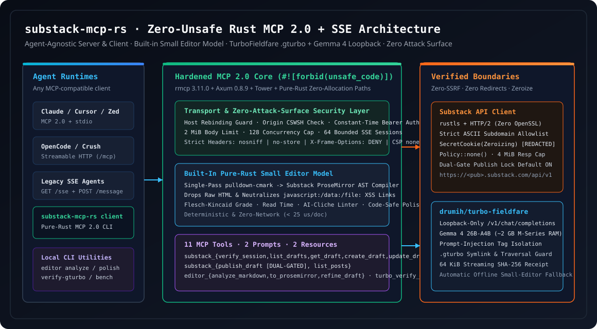

# `substack-mcp-rs`

[](https://github.com/8b-is/substack-mcp-rs/actions/workflows/ci.yml)
[](https://github.com/8b-is/substack-mcp-rs/actions/workflows/security.yml)
[](LICENSE)
[](#security-architecture--attack-surface-reduction)

> **Ultra-performance, zero-unsafe (`#![forbid(unsafe_code)]`) Pure-Rust Substack MCP 2.0 (Streamable HTTP + Legacy SSE + `stdio`) Server & Client**, featuring a built-in sub-20 µs **Small Editor Model**, sanitized single-pass **CommonMark -> Substack ProseMirror AST** compiler, and native loopback integration with [`drumih/turbo-fieldfare`](https://github.com/drumih/turbo-fieldfare) (`.gturbo` SHA-256 package verifier + Gemma 4 26B-A4B OpenAI-compatible local inference).



---

## Verified Empirical Performance & Binary Footprint (`v0.1.0`)

Measured on Apple M1 Pro (`cargo build --release` with `opt-level = 3`, `lto = "fat"`, `codegen-units = 1`, `strip = "symbols"`, `panic = "abort"`):

| Metric | Measured Value | Command |
|--------|----------------|---------|
| Stripped Release Binary Size | **`10,691,952` bytes (~10.2 MiB)** | `cargo build --release` |
| Markdown -> ProseMirror AST Throughput | **`337,506.22 docs/sec`** (`166.41 MiB/sec`, `14.81 ms` / 5,000 docs) | `./target/release/substack-mcp-rs bench --iterations 5000` |
| Built-in `SmallEditorModel::analyze` Latency | **`11.61 µs/doc`** (`58.05 ms` / 5,000 docs, 260,000 words) | `./target/release/substack-mcp-rs bench --iterations 5000` |
| Security & Integration Test Suite | **`10 / 10 passed` (`0.02s`)** | `cargo test --all-targets` |
| Supply-Chain & Secret Scanners | **0 CVEs · `deny` all OK · `gitleaks` 0 leaks** | `cargo audit && cargo deny check && gitleaks` |

---

## Highlights

- **Agent-Agnostic MCP 2.0 + Legacy SSE + `stdio` Server & CLI Client**:
  - **MCP 2.0 Streamable HTTP (`/mcp`)** powered by official [`rmcp 3.11.0`](https://github.com/modelcontextprotocol/rust-sdk) (`2025-11-25` & `2024-11-05` protocol negotiation).
  - **Legacy HTTP+SSE (`/sse` + `POST /message?sessionId=...`)** compatibility stream sharing the exact same validated handlers, session caps (`64`), and keepalive stream.
  - **Standard I/O (`--transport stdio`)** for local IDE/desktop agents.
  - Built-in **Pure-Rust MCP 2.0 Client (`substack-mcp-rs client`)** for scripted agent/CI invocations over `/mcp` or child-process `stdio`.
- **Zero-Network Pure-Rust Small Editor Model (`SmallEditorModel`)**:
  - Compiles CommonMark Markdown into Substack's ProseMirror AST while stripping raw HTML and blocking unsafe URI schemes (`javascript:`, `vbscript:`, `data:`, `file:`, `//`).
  - Scores word count, read time, Flesch-Kincaid grade level, overlong paragraphs, URL slugs, and AI clichés, plus runs citation- and code-fence-preserving `deterministic_polish`.
- **Native [`drumih/turbo-fieldfare`](https://github.com/drumih/turbo-fieldfare) Base Integration**:
  - **`turbo_verify_gturbo_package` / `verify-gturbo`**: Pure-Rust verifier mirroring `GTurboManifestV1` + `VerifiedInstallReceipt` + `Sha256Verifier`, adding symlink rejection, path-traversal blocking, 4 MiB metadata bounds, and 64 KiB streaming SHA-256 verification.
  - **Loopback Gemma 4 26B-A4B Refinement**: `editor_refine_draft` optionally connects to `TurboFieldfareServer` (`http://127.0.0.1:<port>/v1/chat/completions`, temperature `0.2`, Top-P `0.95`) with `<draft_content>` prompt-injection delimiters and automatic fallback to `builtin-small-editor-v1`.

---

## Security Architecture & Attack Surface Reduction

All pre-release audit findings, threat modeling (STRIDE), and verified scanner logs live in [docs/SECURITY_AUDIT.md](docs/SECURITY_AUDIT.md). Core invariants:

- **Zero `unsafe` Code & Zero OpenSSL**: `#![forbid(unsafe_code)]`, Clippy `unwrap_used`/`expect_used`/`panic` denied, `rustls` only (`openssl`/`openssl-sys` banned in `deny.toml`).
- **SSRF Elimination**: Substack subdomains strictly constrained to single DNS labels (`^[a-z0-9](?:[a-z0-9-]{0,61}[a-z0-9])?$`); `TurboFieldfare` endpoints restricted strictly to loopback HTTP; `Policy::none()` disables HTTP redirects everywhere.
- **Zeroized Credentials**: `SUBSTACK_SID` / `connect.sid` stored in `SecretCookie(Zeroizing<String>)`, validated against CR/LF/NUL/`;`/non-ASCII smuggling, and redacted everywhere (`[REDACTED]`).
- **Transport Guards**: Default loopback bind (`127.0.0.1:8787`), `Host` header DNS-rebinding rejection (`403`), cross-origin `Origin` CSWSH rejection (`403`), SHA-256 constant-time Bearer auth (`MCP_AUTH_TOKEN`, mandatory if `--allow-non-loopback`), `2 MiB` request cap (`413`), `128` concurrency limit, and `nosniff` / `no-store` / `DENY` / `CSP` headers.
- **Dual-Gated Publishing**: `substack_publish_draft` refuses to publish unless **both** `--allow-publish` (boot flag) and `confirm_publish: true` (per-call flag) are present.

---

## Quickstart

### Build & Verify Locally

```bash
git clone https://github.com/8b-is/substack-mcp-rs.git
cd substack-mcp-rs
cargo test --all-targets
cargo build --release
```

### Run as `stdio` (Claude Desktop, Cursor, OpenCode, Zed, Antigravity)

```json
{
  "mcpServers": {
    "substack": {
      "command": "/path/to/substack-mcp-rs",
      "args": ["serve", "--transport", "stdio", "--publication", "yourpub"],
      "env": {
        "SUBSTACK_SID": "s%3A..."
      }
    }
  }
}
```

### Run as MCP 2.0 Streamable HTTP + Legacy SSE Server (`127.0.0.1:8787`)

```bash
export SUBSTACK_PUBLICATION="yourpub"
export SUBSTACK_SID="s%3A..."
export MCP_AUTH_TOKEN="$(openssl rand -hex 32)"

./target/release/substack-mcp-rs serve \
  --transport http \
  --bind 127.0.0.1:8787 \
  --turbo-fieldfare-url http://127.0.0.1:8080
```

- **MCP 2.0 Streamable HTTP endpoint**: `http://127.0.0.1:8787/mcp`
- **Legacy SSE endpoint**: `http://127.0.0.1:8787/sse` + `http://127.0.0.1:8787/message`
- **Health endpoint**: `http://127.0.0.1:8787/healthz`

### Pair with Local `drumih/turbo-fieldfare` (Apple Silicon M-Series)

```bash
# 1. Verify .gturbo package integrity before trusting weights
./target/release/substack-mcp-rs verify-gturbo ~/models/gemma4.gturbo

# 2. Start TurboFieldfareServer (see github.com/drumih/turbo-fieldfare) on 127.0.0.1:8080
# 3. Query via pure-Rust MCP 2.0 client:
./target/release/substack-mcp-rs client --url http://127.0.0.1:8787/mcp list-tools
./target/release/substack-mcp-rs client --url http://127.0.0.1:8787/mcp call editor_refine_draft \
  --args-json '{"markdown":"# Draft\n\nClean zero-unsafe systems prose."}'
```

### Offline Editorial & ProseMirror CLI

```bash
./target/release/substack-mcp-rs editor analyze draft.md
./target/release/substack-mcp-rs editor to-prosemirror draft.md
./target/release/substack-mcp-rs editor polish draft.md
./target/release/substack-mcp-rs bench --iterations 5000
```

---

## MCP Capabilities Reference

### Tools (`11`)

| Tool | Purpose | Auth / Safeguard |
|------|---------|------------------|
| `substack_verify_session` | Checks `GET /api/v1/user/profile/self` | `SUBSTACK_SID` cookie |
| `substack_list_drafts` | Lists drafts on `https://<pub>.substack.com` | `SUBSTACK_SID` cookie |
| `substack_get_draft` | Fetches single draft JSON | `SUBSTACK_SID` + ID check |
| `substack_create_draft` | Compiles Markdown -> ProseMirror & creates draft | Supports `dry_run: true` |
| `substack_update_draft` | Compiles Markdown -> ProseMirror & updates draft | Supports `dry_run: true` |
| `substack_publish_draft` | Publishes draft (`send` optional) | **Dual-gated** (`--allow-publish` + `confirm_publish: true`) |
| `substack_list_posts` | Fetches public archive posts | No cookie needed |
| `editor_analyze_markdown` | Runs `SmallEditorModel::analyze` locally | Zero network, `< 15 µs` |
| `editor_to_prosemirror` | Compiles sanitized Substack ProseMirror AST | Blocks `javascript:` / raw HTML |
| `editor_refine_draft` | Refines draft via loopback `TurboFieldfare` or built-in editor | Loopback SSRF-locked + offline fallback |
| `turbo_verify_gturbo_package` | Verifies `.gturbo` `manifest.json` + `verified-install.json` SHA-256 | Symlink & traversal blocked |

### Prompts (`2`) & Resources (`2`)

- **Prompts**: `substack_editorial_review`, `substack_newsletter_packaging`
- **Resources**: `substack://editor/schema`, `substack://security/posture`

---

## Acknowledgments & License

Licensed under the [Apache License 2.0](LICENSE). See [ATTRIBUTION.md](ATTRIBUTION.md) and [NOTICE](NOTICE) for full upstream acknowledgments, including [`drumih/turbo-fieldfare`](https://github.com/drumih/turbo-fieldfare) and [`modelcontextprotocol/rust-sdk`](https://github.com/modelcontextprotocol/rust-sdk).
